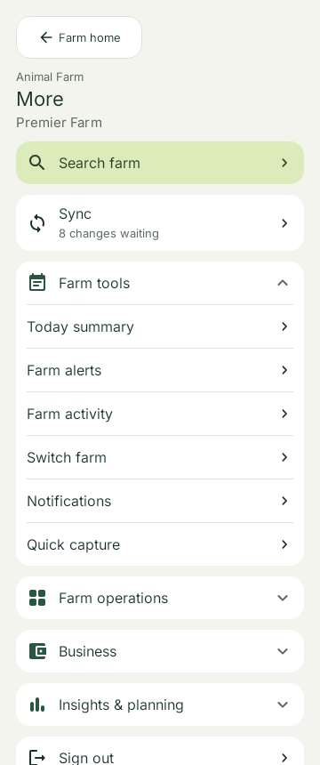
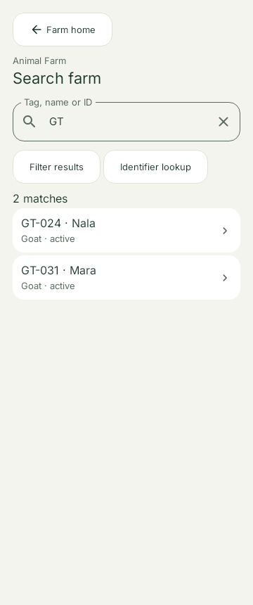
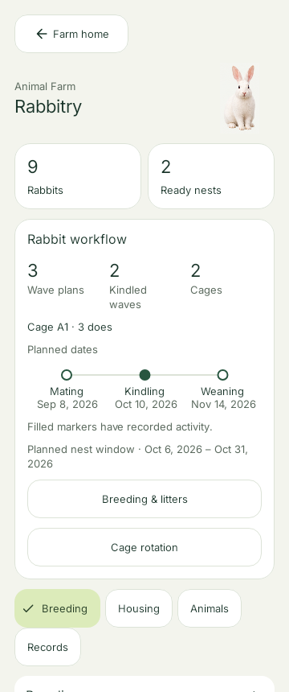
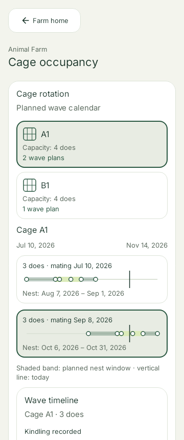

# Native UX review candidates

These are native Compose/Robolectric captures from deterministic test fixtures at 360 x 860, SDK 36. Outdoor captures use 200% text and the app's outdoor touch targets. They are review candidates, not approved reference images.

The exact source, focused test results and image hashes are in [validation.json](validation.json). The production changes and acceptance boundary are in [the review](../../2026-10-18-ux-repair.md).

| Surface | Light | Dark | Outdoor / 200% |
| --- | --- | --- | --- |
| Home | [light](home-light.png) | [dark](home-dark.png) | [outdoor](home-outdoor.png) |
| More menu | [light](menu-light.png) | [dark](menu-dark.png) | [outdoor](menu-outdoor.png) |
| Search suggestions | [light](search-light.png) | [dark](search-dark.png) | [outdoor](search-outdoor.png) |
| Rabbitry | [light](rabbitry-light.png) | [dark](rabbitry-dark.png) | [outdoor](rabbitry-outdoor.png) |
| Cage rotation | [light](cage-rotation-light.png) | [dark](cage-rotation-dark.png) | [outdoor](cage-rotation-outdoor.png) |
| Nest cycle | [light](nest-cycle-light.png) | [dark](nest-cycle-dark.png) | [outdoor](nest-cycle-outdoor.png) |
| Breeding timeline | [light](breeding-timeline-light.png) | [dark](breeding-timeline-dark.png) | [outdoor](breeding-timeline-outdoor.png) |
| Tasks | [light](tasks-light.png) | [dark](tasks-dark.png) | [outdoor](tasks-outdoor.png) |

Empty states: [Search](search-empty-light.png) · [Rabbitry](rabbitry-empty-light.png).

## Primary light-mode previews

| More menu | Search suggestions |
| --- | --- |
|  |  |

| Rabbitry | Cage rotation |
| --- | --- |
|  |  |
